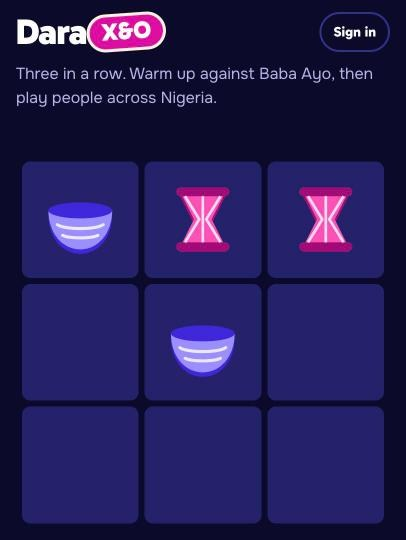
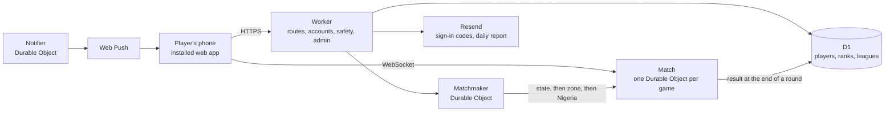

# Dara X&O

Tic tac toe for Nigerian players, the Naija way. **Play it at [daraxando.yveskwameh.com](https://daraxando.yveskwameh.com).**



Play people in your state, your zone or all of Nigeria, play a friend with a 5-letter code, or warm up against Baba Ayo, the game's bot. There are four modes from 3×3 to 7×7, 20 Nigerian titles from JJC to Idan, folktale avatars, Ankara prints, Dara Seeds to stake on matches, day streaks, weekly leagues and ranks by state. It installs on a phone like an app and is built for cheap Android phones on mobile data.

Designed and built by [Yves Kwameh](https://yveskwameh.com).

## At a glance

| | |
| --- | --- |
| Frontend | React 19, Vite 8, TypeScript, plain CSS with design tokens |
| Realtime | Cloudflare Durable Objects, one per match, over WebSockets |
| Backend | Cloudflare Workers |
| Database | Cloudflare D1 |
| Sign-in | Guest by default, with Google or an emailed code to save progress |
| On the phone | Installable web app, push notifications, offline play against the bot |
| First download | About 89 KB of gzipped JavaScript |
| Hosting cost | $0 on Cloudflare's free plan, up to about 300,000 games a month |
| Tests | Unit tests for the rules of every mode, the bot, stakes, safety, notifications and the daily report |

## How it fits together



The page itself is static files, so a page view costs nothing. Every match runs on its own small server, a Match Durable Object, which checks every move, runs the clock and decides the winner. The Matchmaker looks for an opponent in your state first, then your zone, then the whole country, and offers Baba Ayo if nobody comes. Results are written to D1 at the end of each round.

## Five decisions that shaped it

**1. Cloudflare instead of a VPS, Firebase or Vercel.** Before writing any code I compared a VPS with Socket.IO or Colyseus, Firebase, Ably or Pusher, Vercel and Next.js, and priced each at 300,000, 1 million and 10 million games a month. Cloudflare won on running cost, on having a data centre in Lagos, and on needing no server to patch. The full comparison is in [docs/STACK.md](docs/STACK.md).

**2. One small server per match, asleep between moves.** Tic tac toe is turn based, so match objects use WebSocket Hibernation and are evicted from memory while players think. The board rides on each player's socket attachment, and storage is only written at the start and end of a round. The bill counts the milliseconds a move takes, not the minutes a match lasts.

**3. The server owns the rules.** Every move is checked by the match's server, so a modified client can't cheat. The browser counts the clock down and asks the server to check when time is up, because a server timer would keep the object awake and billed.

**4. Built for cheap phones on mobile data.** The first download is about 89 KB. The game screen, sounds and confetti load after the first screen is up, Motion loads in its lightweight form after first paint, fonts are self-hosted, and every icon, piece and avatar comes from one SVG sprite. Every change is checked at 320, 360 and 390 px wide.

**5. Reviewed before launch.** A lawyer approved Dara Seeds, streak items, the age confirmation, the safety rules, the privacy notice and the terms. Seeds can't be bought, sold, sent or cashed out, which keeps the game a game and not gambling. A native speaker approved every Yoruba, Igbo and Hausa word, the 20 titles and the words the name filter blocks.

## How I build it

I research and choose the stack, design every screen, and write the decisions and rules the project follows in [CLAUDE.md](CLAUDE.md) and [DESIGN.md](DESIGN.md). AI coding agents build against those documents, and I review and test every change before it ships. A change is done only when typecheck, tests and the production build pass and the changed screens have been checked on phone widths.

## Run it locally

You need Node 22 or newer.

```sh
npm install
cp .dev.vars.example .dev.vars   # fill in the values you need, see docs/OPERATIONS.md
npm run dev                      # http://localhost:5173
```

That one command runs the app with live reload, the Worker, the Durable Objects and D1 together, inside Cloudflare's own runtime. A normal window and a private window are two different players, so you can play yourself on one computer. On your machine, sign-in codes print in the terminal instead of being emailed.

| Command | What it does |
| --- | --- |
| `npm run dev` | Runs the whole game locally with live reload |
| `npm run typecheck` | Checks the TypeScript across the app and the server |
| `npm test` | Runs the unit tests |
| `npm run build` | Makes the production build and shows the download size |
| `npm run preview` | Serves the production build on port 4173 |

## Where things are

| Folder | What's in it |
| --- | --- |
| `src/` | The app players see: screens, bottom sheets, components, legal pages, art, styles |
| `shared/` | Code both sides use: rules, modes, Baba Ayo, progression, stakes, habits, places |
| `worker/` | The server: routes, Match, Matchmaker, Notifier, accounts, safety, admin, push, reports |
| `migrations/` | Database tables, one file per change |
| `tests/` | Unit tests |
| `docs/` | Design and engineering decisions, reviews and the launch checklist |

## Docs

| Doc | What's in it |
| --- | --- |
| [DESIGN.md](DESIGN.md) | Colours, type, spacing, buttons and every component |
| [docs/STACK.md](docs/STACK.md) | Why this stack, and what it costs as players grow |
| [docs/BACKEND.md](docs/BACKEND.md) | How each part of the backend was built, and why |
| [docs/MATCHMAKING.md](docs/MATCHMAKING.md), [docs/GAME-MODES.md](docs/GAME-MODES.md) | Matching by state and zone, and the four modes |
| [docs/RETENTION.md](docs/RETENTION.md) | Research on the first game and on bringing players back |
| [docs/STAKES.md](docs/STAKES.md) | Dara Seeds and the rules that keep it a game |
| [docs/CULTURE.md](docs/CULTURE.md) | Prints, pieces, avatars, titles and the game's voice |
| [docs/PHONE-FEATURES.md](docs/PHONE-FEATURES.md) | Installing, updates, notifications, sound and haptics |
| [docs/OPERATIONS.md](docs/OPERATIONS.md) | Deploys, secrets, the two Cloudflare copies and troubleshooting |
| [docs/LAUNCH.md](docs/LAUNCH.md) | The launch checklist |

## Contact

Questions about the game, or privacy requests: [hello@yveskwameh.com](mailto:hello@yveskwameh.com)
